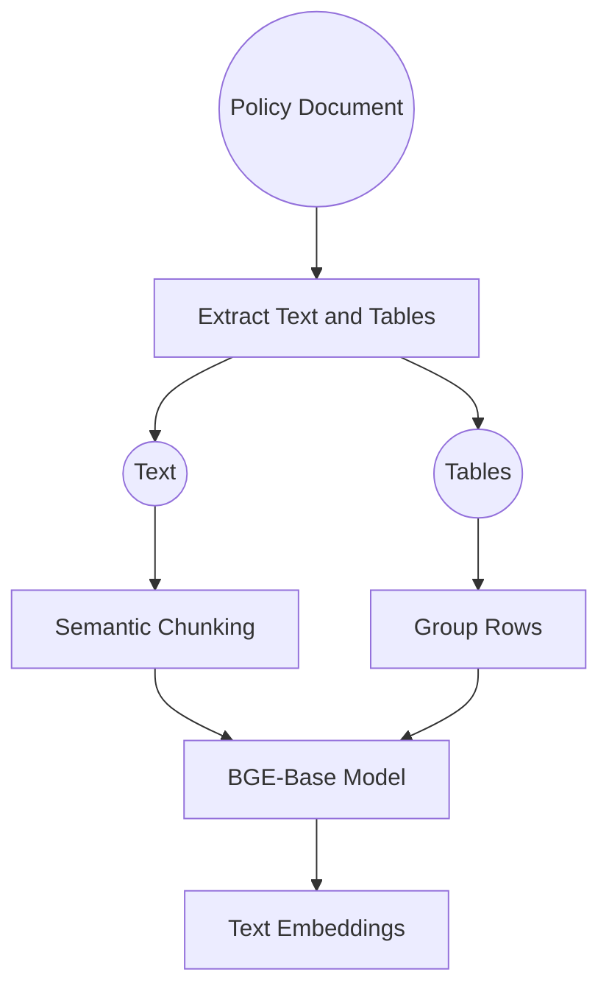
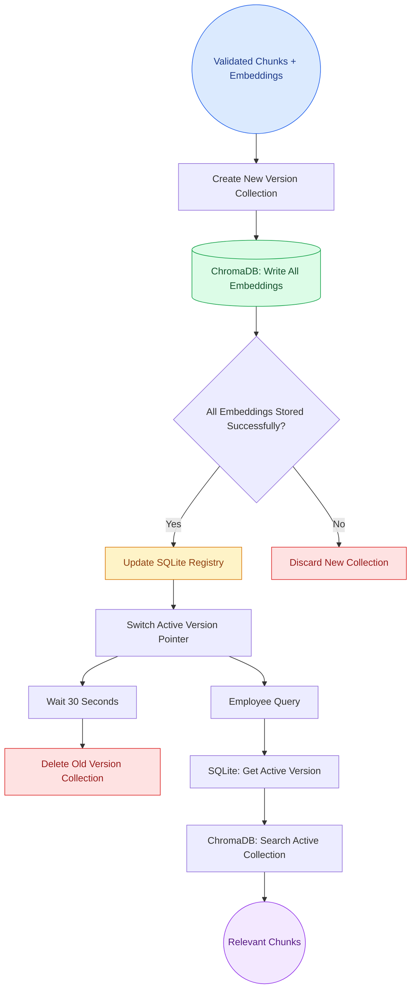
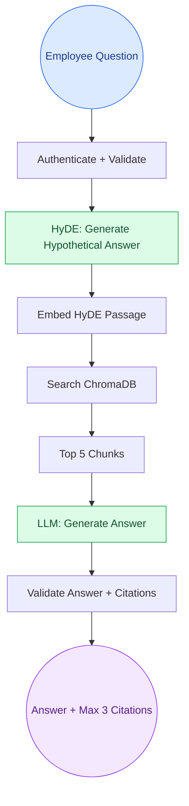

# Commute Policy Assistant

Stack: Python 3.11, FastAPI, ChromaDB with local bge-base embeddings (ONNX via fastembed), SQLite (version registry), JWT (HS256), Groq for the LLM.

## Run it

**You need:** Docker Desktop (running), an internet connection, and a free [Groq](https://console.groq.com) API key.

**1. Get the code and add your key**
```bash
git clone https://github.com/CrazYRobotEnthusiast/commute-policy-assistant
cd commute-policy-assistant
cp .env.example .env        # Windows PowerShell: copy .env.example .env
```
Open `.env` and put your key after `groq_key=`. (Tests and the offline evaluation need no key.)

**2. Start the app** (the one command)
```bash
docker compose up --build
```

**3. Use it.** When the log shows `Application startup complete`, open **http://localhost:8000**.

**4. Stop it.** Press `Ctrl+C`, then run `docker compose down`.

### How long to wait

| Step | First time on a machine | Every time after |
|---|---|---|
| `docker compose up --build`: build | **5 to 15 minutes.** It downloads the Python packages and a 210 MB embedding model; about 14 minutes on a slow connection. Don't cancel it: a cancelled step starts again from zero | seconds (about 1 minute if the code changed) |
| App ready after the build | about 15 to 20 s: it loads the model and indexes the three sample policies | about 5 to 10 s |
| First question | about 2 s | about 1.5 to 2.5 s (it waits for HyDE and the answer, two AI calls) |

### Tests and evaluation

| What | Command | Time |
|---|---|---|
| **Tests** (123, offline: no key, no network, no model download) | `docker compose run --rm app pytest -q` | about 15 to 35 s |
| **Evaluation, offline check** (36 cases through the real pipeline with a stand-in model; checks wiring and output format, not answer quality) | `docker compose run --rm app python -m eval.run_eval --llm fake` | about 25 s |
| **Evaluation, real model** (the pipeline as the app runs it, scored by an LLM judge that knows the reference answers; needs `groq_key`) | `docker compose run --rm app python -m eval.run_eval --llm groq --repeats 1` | about 20 min |

The real evaluation's results are in `eval/results/` (JSONL in the required `id, input, expected, actual, pass, notes` format, plus summaries). They are analysed in **[docs/evaluation.md](docs/evaluation.md)**. A real run **replaces** the committed results file; add `--out eval/results/my_run` to keep it.


### If something goes wrong

* **`no such host` or a timeout while building:** the machine can't reach Docker's servers. Check the internet connection (and any VPN), then run the same command again; finished steps are cached.
* **The page loads but every question says "try again":** the Groq key is missing or wrong in `.env`, or there is no internet. The app needs the internet for every question.
* **The very first question is slow or says "try again":** on a slow computer the model can still be warming up. Ask again.
* **After pulling new code,** always use `docker compose up --build`. Plain `docker compose up` reuses the old image.

### Try it in the browser

Open **http://localhost:8000**. Pick a company and a role:

* **Employee:** choose grade, shift and gender (the profile that goes into the prompt; "not provided" leaves one out), then ask a question. The page shows the status, the answer, the citations (document, version, section, table rows) and the number of LLM calls and the time. A side panel shows exactly what is sent: the request body is only the question; the company and profile travel in the signed token.
* **Admin:** see each company's active version and upload a new policy version for the admin's own company (or click "Upload sample: acme_v2.md"). Then switch to Employee and ask again to see the new version answer.

The page signs you in through `POST /demo/login`, which mints the same signed token `scripts/issue_token.py` does, so no manual token step is needed. **This is demo mode** (`DEMO_MODE=true`, set in `docker-compose.yml`; the code default is off): anyone who can reach the server can sign in as any company, which a real deployment must never allow. With demo mode off, `/` and `/demo/*` do not exist, and `/ask` and `/admin/ingest` behave exactly as before (the company only ever comes from the verified token).

| Route | Auth | Purpose |
|---|---|---|
| `POST /ask` `{"question": "..."}` | employee JWT | grounded, cited answer |
| `POST /admin/ingest` (form: `version`, `file`) | admin JWT | add a new policy version for the admin's own company |
| `GET /whoami` | employee JWT | shows what the server reads from the token |
| `GET /health` | none | liveness |

`/ask` returns `status` = `answered` / `not_covered` / `cannot_answer` (HTTP 200) or `try_again` (HTTP 503 + `Retry-After`), plus `answer`, `citations[]` (document, version, section id and title, table rows, excerpt), `llm_calls`, `latency_ms`.

## The Design Journey
## 1. Policy Processing Pipeline

### Understanding the scale

MoveInSync caters to 400+ companies, each having an employee transport policy of around 30 pages. Let's assume each company updates its policy twice a year. This gives us:

\[
2 \times 30 \times 400 = 24,000 \text{ pages/year}
\]

That's roughly 24,000 pages that need to be processed, chunked and embedded every year.

We can assume that these updates will be spread throughout the year, rather than all companies updating their policies at the same time. So, we don't need to worry too much about sudden spikes in processing load.

### Processing the documents

These policies will mostly contain two types of content: text and tables (for things like pickup timings, eligibility rules, charges, etc.). Images probably won't make up a significant part of these documents. If they do, we can always look into multimodal embedding models.

The first step is to separate text and tables while making sure we don't lose their structure.

- **Digital PDFs:** We can use [Docling](https://github.com/docling-project/docling) for extracting text and tables.
- **Scanned PDFs:** We can use reliable OCR along with table extraction models like Table Transformer. Here, accuracy matters more than processing speed.

For this implementation, we'll keep things simple and use Python scripts to process Markdown files directly.

### Chunking and embedding

Once we have separated the text and tables, we process them differently:

- **Text:** Semantic chunking, while making sure chunks don't cross section boundaries.
- **Tables:** Group rows into smaller chunks. We repeat the table caption and header in every chunk so that each group of rows makes sense on its own.

Both types of chunks are then passed through the same embedding model.

### Choosing the embedding model

I experimented with two embedding models: `all-MiniLM-L6-v2` and `BAAI/bge-base-en-v1.5` (E1).

The experiment used 529 policy passages and 48 questions. Each question was also rephrased in different ways to check how well the models handled variations in wording.

| Metric | MiniLM | BGE-Base |
|---|---:|---:|
| Recall@5 | 77% | **87%** |
| Recall@3 | 70% | **76%** |
| Reworded questions answered fully (Top 5) | 61% | **75%** |
| Synonym-based questions answered fully | 42% | **67%** |
| Query embedding time | 4 ms | 22 ms |
| Model size | 90 MB | 210 MB |

BGE-Base performed better on 7 questions, worse on 1 and equally on 40. The results are promising, although the improvement isn't statistically conclusive.

**Decision: BGE-Base (`BAAI/bge-base-en-v1.5`).**

I decided to go with BGE-Base because it handles differently worded questions better. An employee might use completely different words from those used in the actual policy, so this improvement is important for our use case.

The trade-off is a larger model and slightly higher embedding time (22 ms vs 4 ms). I think that's reasonable given the improvement in retrieval quality.

One more thing: BGE-Base produces a different range of similarity scores, so we also had to adjust our not-covered threshold from 0.30 to 0.50.

You can find the detailed experiment, results and limitations in [docs/experiments.md](docs/experiments.md#e1-embedding-model).

## 2. Policy Ingestion in VectorDB Pipeline

Now that we have our chunks and embeddings, we need to store them in ChromaDB.

One important thing to handle here is **policy updates**. Suppose Acme already has policy `v1`, and employees are currently querying it. Now Acme uploads a new policy `v2`.

We cannot simply delete `v1` and start writing `v2`. What if the upload fails halfway through? Employees would be left with an incomplete or missing policy.

So, I decided to use a version-based approach.

### How does it work?

1. **Create a new collection:** We create a separate ChromaDB collection for the incoming policy version. The existing collection remains untouched, and employees continue querying it.

2. **Store and verify embeddings:** We write all the new embeddings into this collection. Only when all embeddings are stored successfully do we proceed further. If anything fails, we discard this new collection and keep serving the old version.

3. **Switch the active version:** Once the new collection is ready, we update the SQLite registry. This happens inside a single transaction, which retires the old version, activates the new one and updates the `active_version` pointer.

4. **Clean up the old collection:** We wait for 30 seconds before deleting the old collection. This gives requests that were already using the previous version some time to finish.

### What happens if something crashes?

The important thing is that the old version remains active until the new version is completely ready.

We also handle crashes during ingestion. If the application restarts and finds leftover `staging` entries, it marks them as failed and removes collections that aren't associated with an active version.

This way, we don't end up serving a partially uploaded policy.


## 3. Query Answering Pipeline

This is where everything comes together. An employee asks a question, and we need to retrieve the relevant parts of their company's policy and generate an answer based on them.

### How did we arrive at our retrieval strategy?

One of our initial requirements was to **limit the answer to a maximum of 3 citations**. So, the simplest approach was to retrieve only the top 3 chunks and pass them to the LLM.

However, we wanted to make sure these 3 chunks actually covered all the information needed to answer a question. This led us to explore MMR (Maximal Marginal Relevance), which tries to select relevant chunks while avoiding too much overlap between them.

We compared four setups in experiment E2:

- Top 3 most similar chunks.
- Top 3 selected using MMR from a pool of 10.
- Top 5 most similar chunks.
- Top 5 selected using MMR from a pool of 15.

**Results:**

| Metric | Top 3 | Top 3 + MMR | Top 5 | Top 5 + MMR |
|---|---:|---:|---:|---:|
| Average facts found | 0.76 | 0.76 | **0.87** | 0.82 |
| Questions with all required facts retrieved | 67% | 69% | **81%** | 77% |

The results showed that:
- Increasing the number of retrieved chunks from 3 to 5 improved the average facts retrieved from 0.76 to 0.87.
- MMR did not provide any meaningful improvement. None of the 32 combinations of its parameters and candidate pool sizes performed better than plain Top 5 retrieval.

**Our final decision:** Retrieve the top 5 chunks based on relevance, but enforce a hard limit of 3 citations in code. The LLM can never return more than 3 citations in the final response. If it provides more, our code retains only the 3 best-ranked chunks it cited.

This gives the LLM more context while keeping the citation limit independent of the model's behaviour.

### Does HyDE actually help?

We also wanted to explore whether HyDE (Hypothetical Document Embeddings) could improve retrieval.

The idea is simple: instead of searching directly with the employee's question, we ask an LLM to generate a hypothetical policy passage that could answer it. We then embed this passage and use it for retrieval.

For example, an employee might ask:

*"Can I get a cab drop after 9 PM?"*

The hypothetical passage would be written in the style of an actual policy clause. This might help bridge the gap between how employees ask questions and how policies are written.

We ran two experiments:

- **E3:** Tested HyDE with BGE-Base.
- **E4:** Tested HyDE with MiniLM as well, to see whether it helped the weaker embedding model more.

For our main setup (Top 5 retrieval), the results were:

| Embedding Model | Without HyDE | With HyDE | Improvement |
|---|---:|---:|---:|
| BGE-Base | 0.924 | 0.930 | +0.005 |
| MiniLM | 0.854 | 0.883 | +0.029 |

HyDE did provide some improvement, particularly with MiniLM. However, neither result met our predefined requirement of at least +0.05 improvement with the confidence interval entirely above zero.

### So, why did we still keep HyDE?

Even though the retrieval improvement was quite small, we decided to keep HyDE enabled.

The reason was that it still fit within our latency and LLM-call constraints:

- Maximum **2 LLM calls per question**: one for HyDE and one for answer generation.
- Target **p95 latency below 3 seconds**.

On our evaluation machine, enabling HyDE increased p95 latency from 1.58 seconds to 2.39 seconds, while the median increased from 0.96 seconds to 1.52 seconds.

So, we were able to stay within our latency target while using HyDE.

### What does the final pipeline look like?

With these experiments and decisions in place, our current query pipeline works as follows:

1. **Authentication:** We first validate the employee's JWT. The company ID and employee profile are obtained from the verified token. This ensures that employees can only access their own company's policy.

2. **HyDE:** We send the employee's question to an LLM and generate a hypothetical policy passage that could answer it.

3. **Embedding and retrieval:** We embed both the original question and the hypothetical passage using BGE-Base. We search the active ChromaDB collection using both representations.

4. **RRF (Reciprocal Rank Fusion):** We combine the rankings obtained from the original question and the HyDE passage using RRF to get a single ranked list, and keep the top 5 chunks.

5. **Isolation check:** Before anything goes to the answering LLM, we check every chunk that came back from the search (not only the final 5) to make sure it belongs to the authenticated company and the active version. If even one doesn't, we refuse the request and no answer is generated.

6. **Similarity check:** If even the best chunk is only weakly related to the question (similarity below 0.50), we reply that the policy doesn't cover this and point the employee to the transport desk. No answer-generation call is needed.

7. **Answer generation:** The LLM receives the question, the employee's profile and the 5 chunks. The chunks are marked as reference text, not instructions, so anything written inside a policy can't give the model orders. It replies in a fixed JSON format with the answer and the chunks it used.

8. **Validation:** The LLM's reply is treated as untrusted, so our code checks it. The JSON must be valid, every cited chunk must be one of the 5 we retrieved, and at most 3 citations are kept (the 3 best-ranked if it cites more). If anything is wrong, the employee gets a safe "couldn't find a reliable answer" message instead.

9. **Citations:** The document, version, section and table rows shown to the employee are built from the data stored with each chunk, never from the LLM's text. This way, the model can't make up a section.

10. **Response:** The employee gets one of four outcomes: an answer with citations, "not covered", "couldn't find a reliable answer", or a clear "try again" if the AI service is slow or unavailable. All of this happens inside the shared time limit.




### Are the answers actually grounded? (E5)

Retrieval can find the right chunks and the LLM can still say something the policy doesn't. To check this, we ran a groundedness experiment (E5) on the final pipeline.

For 3 questions (a profile-based rule, a table lookup and a two-part question), one LLM listed every claim in the answer and a second LLM from a different model family (Qwen) checked each claim against the retrieved chunks, quoting its evidence. Our code then confirmed that each quote really appears in that chunk. To test the checker itself, we also planted a wrong number and an invented sentence in each answer.

**Results:** all 5 claims were grounded (3 stated directly, 2 derived by applying a stated rule), with no false alarms. The invented sentence was caught 3 out of 3 times and the wrong number 2 out of 3. The miss changed "after 8 PM" to "after 10 PM", which is still true under the rule.

This is only a spot check on three questions, not a measured groundedness rate, and nothing checks answers at runtime. Details are in [docs/experiments.md](docs/experiments.md#e5-groundedness-of-answers).

### Staying within the two numbers

- **At most 2 LLM calls per question.** The usual flow makes two calls: one to generate the hypothetical passage (HyDE), and another to generate the final answer. If HyDE fails, it isn't retried; retrieval simply uses the original question. Questions rejected early by the similarity check don't need an answer-generation call.

- **At most 3 citations per answer.** The system retrieves the 5 most relevant chunks and gives them to the LLM. The answer can cite up to 3 of them. If the LLM cites more, the application keeps the 3 best-ranked citations. It also rejects any citation that wasn't part of the retrieved results.

- **A target of 3 seconds at the 95th percentile.** Embeddings are generated locally, and the request has a shared 5-second time limit across all steps. Individual steps have their own time limits, and the answer-generation call is skipped if too little time remains. On the evaluation machine, with HyDE enabled, the median response time was 1.5 seconds and the 95th-percentile time was 2.4 seconds. Without HyDE, these were 1.0 and 1.6 seconds. See [docs/evaluation.md](docs/evaluation.md).

  The 3-second target is based on the evaluation machine, not a guarantee for every machine. Slower hardware may take longer, up to the 5-second request limit, and may occasionally return a retry response.

### Cross-company isolation

Company identity and policy version are determined from the verified JWT and the version registry, never from the request. Each company and version has its own Chroma collection. Before the LLM is called, every retrieved chunk is checked to ensure it belongs to the authenticated company and active version. Citations are restricted to retrieved chunks, and ingestion rejects documents with mismatched company or version details.

### Version updates

New policies are uploaded and verified in a separate staging collection, so the current policy remains available during ingestion. Once the new version is ready, a single SQLite transaction switches the active version. The old collection is deleted after a 30-second grace period to let ongoing requests finish.

If ingestion fails before the switch, the old version stays active. Startup recovery also cleans up incomplete staging data. Version labels are never reused; a rollback is uploaded as a new version.


## Design decisions and trade-offs

**1. Company isolation and policy versioning**

Since the platform serves multiple companies, keeping their policy data isolated was a core design requirement. I considered using a shared ChromaDB collection with metadata filters, but chose a separate collection for each company and policy version instead. This avoids depending on every retrieval query remembering to apply the correct company filter.

I also didn't want a policy update to make the currently active policy unavailable. So, instead of overwriting the existing collection, a new version is ingested and verified separately. Only after successful ingestion does a single SQLite transaction switch the active version. The old collection is cleaned up after a short grace period. This makes policy updates safer even if ingestion fails midway.

**2. HyDE over more involved query rewriting**

I looked at different ways of rewriting employee questions before retrieval, including iterative refinement. I chose to experiment with HyDE because it generates a hypothetical policy-style passage from the question, giving the embedding model a representation that is closer to the language used in the actual policy.

The final flow searches using both the original question and the hypothetical passage, then combines their rankings using Reciprocal Rank Fusion (RRF). This avoids relying entirely on the generated passage and keeps the original question in the retrieval process. Iterative refinement would add a more involved retrieval-and-rewrite loop, whereas HyDE fits into a single additional LLM call. This mattered because I wanted to keep the request within a two-call budget and meet the latency target.

**3. Retrieving more chunks while limiting citations**

My initial approach was to retrieve only 3 chunks because I wanted answers to contain at most 3 citations. I then considered whether MMR could select a more diverse set of chunks, reducing overlap between retrieved results.

In E2, I compared Top 3, Top 5 and different MMR configurations. Plain Top 5 retrieval performed best on the evaluation set. So I separated retrieval depth from the citation limit: the LLM receives the best 5 chunks, but the application allows at most 3 citations. If the model produces more, the application keeps the 3 best-ranked citations among those it selected. This gives the model more context without making the final answer unnecessarily citation-heavy.
## Limitations

* Free-tier Groq rate-limits at roughly 20–25 calls a minute, so a full evaluation run needs pacing; the runner waits and retries on 429 (the wait is excluded from latency).
* The answer model is not deterministic even at temperature 0, so a few cases can flip between runs. The reported run used 1 repeat per case (`--repeats 3` makes a case pass only if all three repeats do, but needs about three times the free-tier tokens); see docs/evaluation.md.
* JWT secret has a dev default for `docker compose`; set `JWT_SECRET` in `.env` for anything real.
* The evaluation set (36 cases) is small and was also used while improving the prompt; differences of a few points are within noise (see [docs/evaluation.md](docs/evaluation.md)).

## Layout

```
app/        main.py (routes) auth.py ingest.py registry.py store.py chunking.py embeddings.py
            retrieval.py (RRF + MMR) answer.py (pipeline + validation) llm.py prompts.py config.py
policies/   acme_v1.md acme_v2.md globex_v1.md initech_v1.md   (contradicting rules; one has a planted injection)
eval/       cases.jsonl  run_eval.py  results/
experiments/ scripts and data to rerun E1-E5 (docs/experiments.md says how)
docs/       experiments.md (objective, method and results of E1-E5), evaluation.md (the 36-case evaluation)
tests/      pytest for the app: fake LLM, fake embedder, throwaway storage per test
scripts/    issue_token.py
```
### Failure behaviour (nothing hangs, nothing half-answers)

| Situation | Employee sees | HTTP |
|---|---|---|
| Policy silent / below cutoff / model says so | "does not cover this, contact the transport desk" | 200 `not_covered` |
| Model returns bad JSON, unknown or fabricated citation, isolation check fails | "couldn't find a reliable answer, contact the transport desk" | 200 `cannot_answer` |
| LLM timeout, 429/quota, 5xx, network, missing key; retrieval slow or failing; no time budget left | "temporarily unavailable, try again" | 503 `try_again` + `Retry-After` |
| Missing/invalid/expired token | generic message (details only in server log) | 401 |
| Company without a policy; employee on an admin route | message | 403 |
| Anything unexpected | plain message + request id, no stack trace | 500 |


## Experiments

Refer **[docs/experiments.md](docs/experiments.md)** .